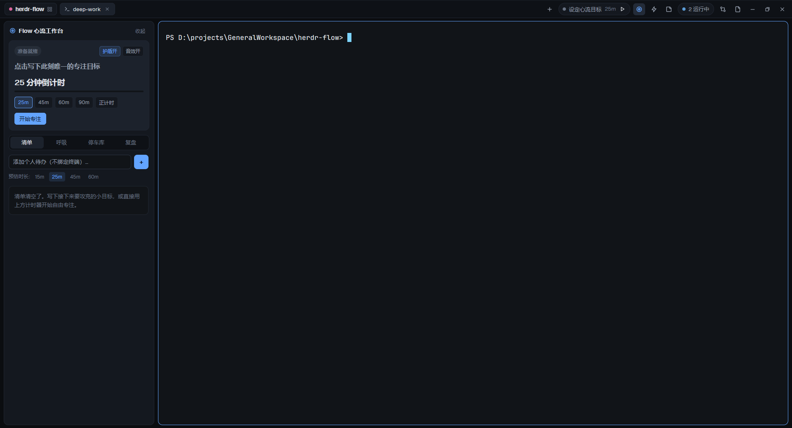

# Herdr Flow

为 [Herdr](https://github.com/herdrdev/herdr-app) 打造的心流工作台布局（`flow`）：将**个人专注工作台**、**Agent 三级收纳与浮窗快批**、**跨机项目全景浏览器**融为一体，尽量把主屏幕留给正在推进的工作。



## 核心特性

1. **个人心流工作台（不绑定 Agent）**
   - **纯个人闯关清单**：独立于终端和 Agent 的待办队列，可预估时长（`15m` / `25m` / `45m` / `60m`）、选定当前主攻目标与勾选完成。
   - **三模式专注计时 + 超流顺延**：支持倒计时（`25m` / `45m` / `60m` / `90m`）与自由正计时；顶栏上方走 2px 无数字环境进度线（不跳秒催命）；到点后只轻响一声并进入**超流顺延**，不弹框打断心流。
   - **杂念闪记 & 悬浮便签**：`Ctrl+Shift+I` 一秒记下突发杂念（存停车库或直接转待办）；`Ctrl+Shift+M` 呼出可拖动的持久化 Markdown 悬浮便签窗。
   - **4-4-4-4 呼吸引导 & 专注护盾**：开工前可跟练 30 秒箱式深呼吸；开启专注护盾后，计时期间的非错误弹窗自动静音收进收件箱。
   - **10 周专注热力图 & 日报导出**：自动统计每日专注时长、完成项、连续天数和挡掉的打扰次数，支持一键复制当日 Markdown 复盘小结。

2. **Agent 三级收纳与浮窗快批**
   - **平时零列表、零转圈动画**：只在顶栏右侧保留一颗状态胶囊（`X 待拍板 · Y 已完工` 或 `Z 运行中`）。
   - **三级自动分流**：点开抽屉自动分为 **① 待你处理**（抓取最近一行终端输出摘要）、**② 后台运行中**（单行紧凑展示，子 Agent 默认折叠为 `+N 子任务`）、**③ 已阅与闲置归档**（默认折叠沉底），并支持一键收纳闲置标签（`tab.settle`）。
   - **不切桌面的悬浮连批**：点击 `快批 ▶` 或任意卡片，在当前桌面上方弹出可拖动的速览批阅窗（`◀ 上一个` / `下一个 ▶` / `收纳后台` / `↗ 切去工作区`），回复完关闭即可，底层工作区纹丝不动。

3. **项目全景浏览器（Exposé）**
   - 点击左上角项目胶囊或按 `Ctrl+Shift+G` 打开多列项目网格，支持按 `全部 / 待处理 / 运行中 / 本机 / 远端 SSH 机器` 筛选与关键词即时搜索。
   - 异步展示各 Space 实时 Git 分支、未提交改动数（`~N 改动`）及 `↑ahead / ↓behind`，支持键盘方向键导航切换、**不切桌面速览终端**（`👁 速览`）以及一键新建本机/远端 Space。

---

## 安装方法

将仓库中的 `layouts/`、`themes/`、`mods/` 复制到你的 Herdr 配置目录（默认 `~/.config/herdr-app`，Windows 为 `%USERPROFILE%\.config\herdr-app`）：

### Windows (PowerShell)

```powershell
git clone https://github.com/Pure-island/herdr-flow.git
$dst = "$HOME\.config\herdr-app"
New-Item -ItemType Directory -Force -Path "$dst\layouts", "$dst\themes", "$dst\mods" | Out-Null
Copy-Item ".\herdr-flow\layouts\flow.json", ".\herdr-flow\layouts\flow.svg" "$dst\layouts" -Force
Copy-Item ".\herdr-flow\themes\flow.json" "$dst\themes" -Force
Copy-Item ".\herdr-flow\mods\flow" "$dst\mods\flow" -Recurse -Force
```

### macOS / Linux

```sh
git clone https://github.com/Pure-island/herdr-flow.git
DST="${HERDR_APP_HOME:-$HOME/.config/herdr-app}"
mkdir -p "$DST/layouts" "$DST/themes" "$DST/mods"
cp herdr-flow/layouts/flow.json herdr-flow/layouts/flow.svg "$DST/layouts/"
cp herdr-flow/themes/flow.json "$DST/themes/"
cp -R herdr-flow/mods/flow "$DST/mods/"
```

切换使用：
- 按 `Ctrl+Shift+L` 轮换布局，或在命令面板（`Ctrl+Shift+P`）选择 **Flow**；也可执行：
  ```sh
  herdr-app do layout.switch '{"name":"flow"}'
  ```
- 按 `Ctrl+Shift+B` 可随时展开或收起左侧 **Flow 心流工作台**。

### 可选快捷键

如需在 `flow` 布局中启用专属快捷键，可将仓库根目录 [keys.json](keys.json) 中的 `"layout:flow"` 段落合并到你的 `~/.config/herdr-app/keys.json`：

| 快捷键 | 功能 | 命令 |
| --- | --- | --- |
| `Ctrl+Shift+G` | 打开项目全景浏览器 | `flow.projects` |
| `Ctrl+Shift+A` | 打开 Agent 三级收纳抽屉 | `flow.agents` |
| `Ctrl+Shift+J` | 浮窗连批最紧急的 Agent | `flow.triage` |
| `Ctrl+Shift+I` | 弹出 1 秒杂念闪记框 | `flow.capture` |
| `Ctrl+Shift+M` | 打开悬浮 Markdown 便签 | `flow.notes` |
| `Ctrl+Shift+D` | 快速开始 / 暂停专注计时 | `flow.toggle_focus` |

---

## 许可证

[MIT](LICENSE)
