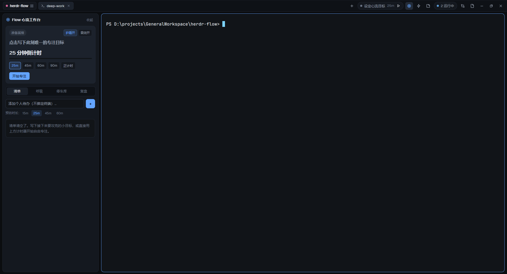

# Flow

A calm, distraction-shielded Herdr layout built for deep work: it keeps a 40px top bar with a non-ticking ambient progress line and an active-tab strip, a toggleable Personal Flow Studio sidebar (task queue, countdown/stopwatch timer with non-intrusive overtime, 4-4-4-4 box breathing, brain-dump parking lot, and a 10-week focus heatmap), a 3-tier Agent Stow drawer with a floating flip-through triage window, a floating Markdown scratchpad, and a multi-column Bird's-Eye Project Overview deck across local and SSH machines.

## What you see

- **Theme (`themes/flow.json`)**: Low-glare deep ink palette: canvas `#0b0d10`, top bar chrome `#0e1116`, terminal background `#111418`, panels `#14181f`, popovers `#171c24`, raised controls `#1c222c`, borders `#202631`, text `#e4e7ec`, muted `#9aa3b2`, dim `#687283`, accent `#63a4ff`, working `#5b9bd5`, blocked `#e59e45`, done `#56b886`.
- **Top bar (`topbar`, 40px tall, `window_drag: true`)**:
  - A 2px full-width ambient progress bar along the top edge (`#63a4ff` during countdown/stopwatch, pulsing `#e59e45` in overtime).
  - Left: Space overview pill (`grid` icon + Space color dot + Space name + optional SSH machine + Git branch), horizontally scrollable visible tab pills, optional `+N 后台` settled-tab pill, and `+` new-tab button.
  - Center: Flow Anchor pill (active goal/task + calm minute readout + Play/Pause/Finish controls) and quick icon buttons for Flow Studio (`target`), Quick Capture (`bolt`), and Floating Scratchpad (`note`).
  - Right: Optional Focus Shield badge (`shield` + buffered count), Agent Stow capsule (`blocked` / `done` / `working` / total count, zero spinners), optional `快批 ▶` triage button when agents wait on you, `Diff` / `Files` context drawer toggles, and Windows/Linux window buttons (`minimize`, `maximize`/`restore`, `close`).
- **Workspace (`workspace`, flexible row, `padding: [6, 8]`, `gap: 8`)**:
  - **Flow Studio sidebar (`sidebar`, 332px wide, min 280px, max 460px, hidden initially)**: Top focus timer hero card + 4 segmented tabs (`清单`, `呼吸`, `停车库`, `复盘`).
  - **Terminal canvas (`main`, `tab: "active"`, `terminal_padding: [16, 18]`)**: 10px rounded panes with 1px `#202631` borders (`#63a4ff` on focus) and a 28px hover-reveal header (`reveal: "hover"`).
  - **Right context stack (`panel`, 368px wide, hidden initially)**: Switches between shipped `changes` and `files` mods.

## How it behaves

- **Personal Flow Studio (decoupled from agents)**:
  - **Timer modes**: `25m`, `45m`, `60m`, `90m` countdown or `正计时` stopwatch. Countdown updates every 5 seconds with minute-level readouts (no ticking seconds). Crossing the target enters **Flow Overtime** (`超流 +Nm`) with a single soft `"done"` chime (when sound is enabled) and no modal interruption.
  - **Tasks (`清单`)**: Pure personal task list with duration presets (`15m`, `25m`, `45m`, `60m`), focus-target selection, check-off completion, and collapsible completed list.
  - **Breathing (`呼吸`)**: 4-4-4-4 box-breathing animated ring (`74px`–`128px`, 950ms native width/height transitions) to settle attention before work.
  - **Parking lot (`停车库`) & Quick Capture (`capture`)**: Pressing `Ctrl+Shift+I` (or clicking the bolt icon) opens a compact dialog (`Enter` stores in Parking Lot; `Shift+Enter` adds directly to Today's Tasks). Items can be promoted to tasks or deleted later.
  - **Floating Scratchpad (`notes`)**: `kind: "window"`, `key: "flow-notes"`, `keep: true` (370×410px). Supports live editing and Markdown preview (`TextView.markdown`), persisted to `shared("flow.store").scratchpad`.
  - **Focus Shield (`toast: "flow"`)**: While the timer is running and `shieldEnabled` is true, non-error notifications are recorded into `shieldedToasts` and immediately closed (`closeOverlay`), preventing popups during deep work.
  - **Stats & Export (`复盘`)**: Today's minutes, completed items, consecutive day streak, blocked interruptions count, a 10-week × 7-day GitHub-style heatmap (`level 0..4`), today's session timeline, and 1-click Markdown summary clipboard export.
- **3-Tier Agent Stow & Flip-Through Peek Triage**:
  - `agents` modal (540×580px) groups agents into **① 待你处理** (`blocked` + `done`, always expanded, fetching the last non-empty terminal line via `hc read`), **② 后台运行中** (`working`, compact rows with collapsible `+N 子任务` sub-agent trees, no spinners), and **③ 已阅与闲置归档** (`idle`, collapsed by default).
  - Clicking an agent (or clicking `快批 ▶` / `flow.triage`) opens `flow-triage` (`kind: "window"`, `key: "flow-triage"`, `0.78 × 0.74` of window size) with `triage-bar` (`◀ 上一个`, `下一个 ▶`, `收纳后台` via `tab.settle`, `↗ 切去工作区` via `pane.focus`/`terminal.keep`, `✕`) above the live `{ terminal }` block, without changing the underlying Space or Tab.
  - Calls `setAgentOrder(...)` on every render so `Alt+Down` / `Alt+Up` match the priority order.
- **Bird's-Eye Project Overview (`projects`)**:
  - Centered dialog (`0.86 × 0.80` of window size) opened by clicking the top-left space pill or running `flow.projects`.
  - Filter chips (`全部`, `待处理`, `运行中`, `本机`, and connected SSH hosts from `hc machine ls --json`) + instant text search + arrow-key/Enter grid navigation (`2` or `3` columns based on width).
  - Queries `git status --porcelain=v2 --branch` via `exec` (local or `on: space.machine`, concurrency cap 4) to show branch, dirty file count, and `↑ahead / ↓behind`. Cards support switching (`space.select`), floating terminal peek (`👁 速览`), and adding a tab (`tab.new`), plus `+ 打开文件夹` (`pickFolder` -> `space.new`) and `+ 远端项目`.

## Built from

- `layouts/flow.json`: Root `column` (`titlebar: "none"`, `toast: "flow"`, `theme: "flow"`, `preview: "layouts/flow.svg"`), `topbar` (`flow` `role: "bar"`), `workspace` row (`sidebar` `flow` `role: "studio"`, `main` `tab: "active"` with hover `flow` `role: "pane"`, `panel` stack with `changes` and `files`).
- `themes/flow.json`: Custom terminal + UI theme tokens.
- `mods/flow/`:
  - `main.js`: Role router + `checking()` full-role render pass.
  - `store.js`: `shared("flow.store")` state model, timer math, heatmap, Markdown report builder.
  - `ui.js`: `alphaColor`, `ownPress`, `spaceColor`, `buildAgentGroups`, `openTriageWindow`, modal launchers.
  - `bar.js`: `role: "bar"` + `nextCommand()` listener (`projects`, `agents`, `triage`, `capture`, `notes`, `toggle_focus`).
  - `studio.js`: `role: "studio"` (hero timer, tasks, breathing, parking lot, heatmap & export).
  - `projects.js`: `role: "projects"` (Space overview grid, async `git status` across local & SSH machines).
  - `agents.js`: `role: "agents"`, `role: "triage-bar"`, `role: "settled"`, plus `close_windows` command listener.
  - `notes.js`: `role: "capture"` & `role: "notes"`.
  - `pane.js`: `role: "pane"` hover-reveal header.
  - `toast.js`: `role: "toast"` / root toast handler for Focus Shield interception.

## Watch out

- Theme colors in preset themes (like `graphite`) may already carry 8-digit `#rrggbbaa` hex values; always derive translucent variants with `alphaColor(hex, aa)` instead of raw string concatenation.
- Herdr strips the `<mod>.` prefix before delivering `<mod>.<command>` to `nextCommand()`, so handlers match `"projects"`, `"agents"`, `"triage"`, `"capture"`, `"notes"`, `"toggle_focus"`.
- `bar.js` sets `"id": "sidebar"` on the Studio node so the built-in `Ctrl+Shift+B` (`layout.toggle:sidebar`) keybinding toggles it automatically; custom `layout:flow` bindings in `keys.json` are optional.
- Git branch/dirty badges require `git` in PATH on the target machine; non-git directories quietly omit Git chips.

## Done when

- `herdr-app check ~/.config/herdr-app/mods/flow` exits `0` with no errors.
- `herdr-app do layout.switch '{"name":"flow"}'` switches the window cleanly with `"errors": []` in `herdr-app status`.
- Opening `flow.projects`, `flow.agents`, `flow.triage`, `flow.capture`, and `flow.notes` renders all overlays with `"errors": []`.
- Switching `sidebar` visible shows the Flow Studio alongside the terminal canvas, and enabling the timer shields non-error toasts into `shieldedToasts`.
